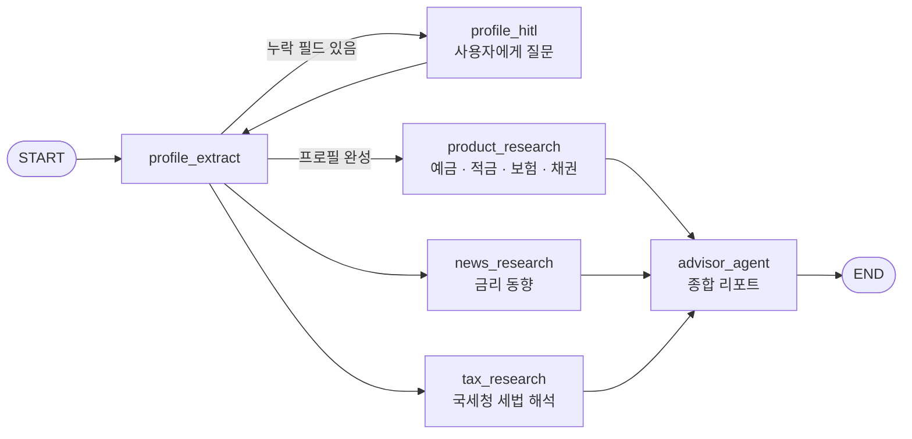

# Wealth Advisor (Langgraph_Asset)

[English](README.md) | **한국어**

LangGraph 기반 멀티 에이전트 자산 상담 플랫폼입니다. 사용자의 재무 프로필과 보유 자산을 바탕으로 세 리서치 에이전트가 금융 상품, 거시경제 뉴스, 세법을 병렬로 조사하고, 상담 에이전트가 이를 하나의 상담 리포트로 종합합니다.

> 분석 결과는 참고용이며 투자 판단의 근거로 사용할 수 없습니다. 금융 상품 가입 전 반드시 해당 금융기관에 직접 확인하세요.

## 동작 방식



- **Human-in-the-loop 프로필**: 필수 프로필 항목이 비어 있으면 리서치 전에 사용자에게 묻습니다.
- **병렬 리서치**: 상품·뉴스·세법 에이전트가 LangGraph `Send`로 동시에 실행됩니다.
- **근거 기반 도구**: Naver 검색 API, Tavily, law.go.kr 국세청 API, 공공데이터포털 청약 API.
- **웹 앱**: 회원가입·로그인(JWT), 프로필·자산 관리, 대시보드, 전략 백테스트, 청약 정보, 관리자 승인.

## 기술 스택

| 계층 | 기술 |
|---|---|
| 에이전트 | LangGraph, LangChain, Gemini 2.5 Flash |
| 리서치 도구 | Naver 검색 API, Tavily, law.go.kr API, 공공데이터포털 API |
| 백엔드 | FastAPI, SQLAlchemy, JWT, SlowAPI |
| 프론트엔드 | Vanilla JS, Tailwind CSS, Chart.js, Leaflet.js |
| 데이터베이스 | PostgreSQL (LangGraph 체크포인터 + 사용자 데이터) |
| 관측 | Langfuse (선택) |

## 빠른 시작

Python 3.11 이상, [uv](https://docs.astral.sh/uv/), Docker(PostgreSQL용)가 필요합니다.

```bash
cp .env.example .env          # API 키, DB URL 입력
uv sync
uv run python scripts/dev.py  # Postgres + 웹 서버 시작, http://localhost:8000
```

필수 환경 변수:

```
GOOGLE_API_KEY
DATABASE_URL
NAVER_CLIENT_ID / NAVER_CLIENT_SECRET
TAVILY_API_KEY
LAW_GO_KR_OC
CHEONGYAK_API_KEY
```

`scripts/dev.py`의 다른 명령:

| 명령 | 설명 |
|---|---|
| `uv run python scripts/dev.py --cli` | Postgres + 터미널 상담 |
| `uv run python scripts/dev.py --https` | HTTPS, https://localhost:8443 |
| `uv run python scripts/dev.py --port 9000` | 포트 지정 |
| `uv run python scripts/dev.py docker` | Postgres만 시작 |
| `uv run python scripts/dev.py stop` | Postgres 종료 |

## 프로젝트 구조

```
src/wealth_advisor/
├── agent/        LangGraph 그래프, state, 노드(프로필, 리서치, 상담), 도구
├── api/          FastAPI 앱, 인증, 라우터(auth, profile, assets, agent, dashboard,
│                 backtest, admin, cheongyak), 정적 파일과 SPA 템플릿
├── db/           SQLAlchemy 엔진과 ORM 모델
├── services/     청약 API 클라이언트, 트레이딩 백테스트 엔진
├── core/         환경 변수 로드, Langfuse 콜백, 로깅
└── cli.py        터미널 대화형 상담 루프
scripts/          dev.py, run_web.py, run_advisor.py
tests/
```
