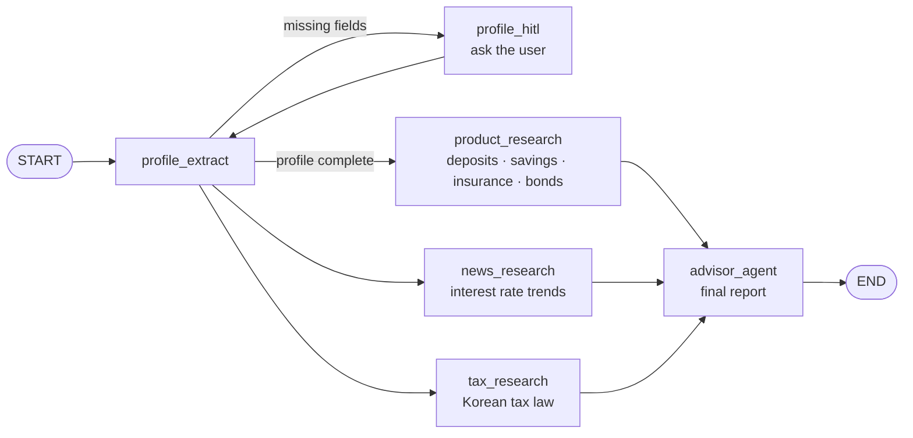

# Wealth Advisor (Langgraph_Asset)

**English** | [한국어](README.ko.md)

A LangGraph multi-agent wealth advisory platform. Based on a user's financial profile and holdings, three research agents look into financial products, macro news, and Korean tax law in parallel, and an advisor agent combines them into one consultation report.

> Analysis results are for reference only and are not investment advice.

## How It Works



- **Profile with human-in-the-loop**: If required profile fields are missing, the graph asks the user before research starts.
- **Parallel research**: Product, news, and tax agents run at the same time with LangGraph `Send`.
- **Grounded tools**: Naver Search API, Tavily, the law.go.kr tax law API, and the public data portal housing subscription API.
- **Web app**: Sign-up and login (JWT), profile and asset management, dashboard, strategy backtests, housing subscription info, and admin approval.

## Tech Stack

| Layer | Technology |
|---|---|
| Agents | LangGraph, LangChain, Gemini 2.5 Flash |
| Research tools | Naver Search API, Tavily, law.go.kr API, public data portal API |
| Backend | FastAPI, SQLAlchemy, JWT, SlowAPI |
| Frontend | Vanilla JS, Tailwind CSS, Chart.js, Leaflet.js |
| Database | PostgreSQL (LangGraph checkpointer + user data) |
| Observability | Langfuse (optional) |

## Quick Start

Requires Python 3.11+, [uv](https://docs.astral.sh/uv/), and Docker (for PostgreSQL).

```bash
cp .env.example .env          # API keys and DB URL
uv sync
uv run python scripts/dev.py  # starts Postgres + web server at http://localhost:8000
```

Required environment variables:

```
GOOGLE_API_KEY
DATABASE_URL
NAVER_CLIENT_ID / NAVER_CLIENT_SECRET
TAVILY_API_KEY
LAW_GO_KR_OC
CHEONGYAK_API_KEY
```

Other `scripts/dev.py` commands:

| Command | Description |
|---|---|
| `uv run python scripts/dev.py --cli` | Postgres + terminal consultation |
| `uv run python scripts/dev.py --https` | HTTPS at https://localhost:8443 |
| `uv run python scripts/dev.py --port 9000` | Custom port |
| `uv run python scripts/dev.py docker` | Start Postgres only |
| `uv run python scripts/dev.py stop` | Stop Postgres |

## Project Structure

```
src/wealth_advisor/
├── agent/        LangGraph graph, state, nodes (profile, research, advisor), tools
├── api/          FastAPI app, auth, routers (auth, profile, assets, agent, dashboard,
│                 backtest, admin, cheongyak), static files and SPA template
├── db/           SQLAlchemy engine and ORM models
├── services/     Housing subscription API client, trading backtest engine
├── core/         Env loading, Langfuse callback, logging
└── cli.py        Terminal consultation loop
scripts/          dev.py, run_web.py, run_advisor.py
tests/
```
